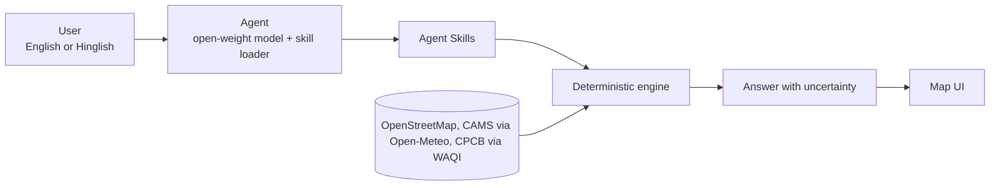

# CleanCommute

**An open-weight AI agent that plans when and how to travel with less air-pollution exposure.**

CleanCommute runs a small open-weight language model locally (through Ollama or llama.cpp). It turns English or Hinglish requests such as *"I need to travel across the city this afternoon. Is there a less polluted route, and would leaving a little later make a difference?"* into structured calls to [Agent Skills](https://agentskills.io/). A deterministic, tested engine produces every number. The model understands the request, picks skills and explains the result, quoting assumptions and uncertainty.

> **Status: early skeleton for Hacktoberfest Hack Day 2026.** The skills are defined; the engine and UI are under construction (see the roadmap). Nothing here has been measured or validated yet.

Demo city: **LUCKNOW** · Team: **CODE CRUSADERS**

## The problem

An AQI number describes a place, not a trip. Published studies suggest that mode, time and route all change what a commuter breathes:

- In Vellore (312 trips), PM2.5 exposure was consistently higher on a traffic route than on a residential route, morning traffic-route trips were more polluted than afternoon trips, and pedestrians and cyclists inhaled 4–8 times more per kilometre than motorised commuters ([Manojkumar et al., *Atmospheric Pollution Research*, 2021](https://research.vit.ac.in/publication/commuter-exposure-concentrations-and-inhalation-doses-in-traffic)).
- In New Delhi auto-rickshaws, in-vehicle PM2.5 was about 1.5 times the simultaneous ambient level ([Apte et al., *Atmospheric Environment*, 2011](https://depts.washington.edu/airqual/Marshall_29.pdf)).
- In Indo-Gangetic Plain winters, a shallower boundary layer and weaker winds reduce ventilation roughly fourfold ([Ojha et al., *Scientific Reports*, 2020](https://pmc.ncbi.nlm.nih.gov/articles/PMC7125076)).

Google Maps shows an air-quality layer by location. IIT Kharagpur's DRUM prototype offers least-exposure routing, simulated on Delhi corridors, with departure-time forecasting and non-motorised modes listed as future work (mid-2025 reports). CleanCommute aims to add departure-time advice, mode-aware dose and honest uncertainty.

## How it works

**Guardrail: the language model never computes exposure.** Concentrations, dose and Monte Carlo uncertainty come from the engine (OSMnx/NetworkX routing graph, hourly concentration estimates, mode-aware inhaled-dose model). The model only chooses skills and explains.

### Agent Skills

Each skill is a folder with a `SKILL.md` (YAML front matter with `name` and `description`) and optional `references/`, following the [Agent Skills specification](https://agentskills.io/specification). Skills load on demand.

| Skill | Purpose |
| --- | --- |
| [`read-station-data`](skills/read-station-data/SKILL.md) | Fetch and summarise recent station readings and forecast shape, with data age |
| [`plan-commute`](skills/plan-commute/SKILL.md) | Compare fastest and lower-exposure routes for a mode |
| [`compare-departure-times`](skills/compare-departure-times/SKILL.md) | Compare departure slots and suggest a leave-by window |
| [`explain-tradeoff`](skills/explain-tradeoff/SKILL.md) | Explain results in plain English or Hindi with assumptions and uncertainty |

Validate them locally: `python tools/validate_skills.py` (also runs in CI).

## Open-source stack

Python · FastAPI · OSMnx / NetworkX · Ollama or llama.cpp · Leaflet · an open-weight instruct model (Qwen, Gemma or Llama family; final pick after a latency test on a laptop). Runs locally, no paid API, privacy-friendly.

## Roadmap

| Item | Status |
| --- | --- |
| Skill definitions (`skills/`) and validator | done in this skeleton |
| Hourly station and forecast logger | planned |
| Routing graph, deterministic dose engine, Monte Carlo uncertainty | planned |
| FastAPI service and Leaflet map UI | planned |
| Validation: held-out-station error below a city-median baseline; short-term forecast error below persistence | target |
| Under 3 seconds per query; at least 4 of 5 test users understand the uncertainty | target |
| Crowdsourced low-cost sensors, higher-resolution data, more cities | planned |
| Hindi voice input with an open-source speech model, contribution guide | planned |

## Limits and honesty

- Public data are sparse: a city like LUCKNOW has only a handful of reporting stations, so street-level values are **estimated, not measured**.
- Route-level differences are **model assumptions**. Time-of-day effects are better supported than street-level ones.
- CleanCommute shows relative exposure. It is **not medical advice**, and no health benefit is claimed.

## Data, attribution and licences

- Code: MIT (see [LICENSE](LICENSE)).
- Map data © OpenStreetMap contributors (ODbL). Air-quality forecasts: CAMS via Open-Meteo, with attribution. Station data: CPCB via WAQI; a WAQI token is required, so check their terms and keep it in `.env`.
- Model weights are **not** included and carry their own licences. Check the licence of the model you choose.
